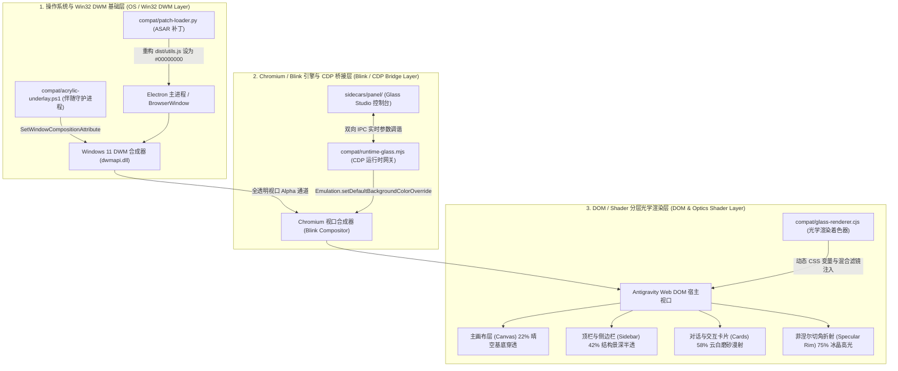

<div align="center">


# SkyAzure Glass (`antigravity-sky-azure`)

### 晴空碧海 · Antigravity 操作系统级窗口透视毛玻璃光学引擎
**OS-Level See-Through Acrylic & Optical Frosted Glass Engine for Antigravity**

[](plugin.json)
[](LICENSE)
[](compat/platform.mjs)
[-0ea5e9.svg?style=flat-square)](compat/preferences.mjs)

<p align="center">
  <b>晴空蔚蓝，碧海无垠 · 贯穿 Win32 DWM、Blink 视口合成器与 DOM 渲染层的全链路桌面毛玻璃引擎</b>
  <br />
  <i>A unified, non-destructive optical engine bringing true behind-window transparency, tactile Gaussian blur, and crisp sky-azure aesthetics to Google Antigravity.</i>
</p>

---

</div>

## 📖 项目概述 (Overview)

**SkyAzure Glass (`antigravity-sky-azure`)** 是一款专为 Google Antigravity 打造的高保真操作系统级透视毛玻璃光学引擎。不同于常规仅在应用内部伪造虚假模糊的 CSS 滤镜，SkyAzure Glass 深入 Windows 桌面窗口管理器 (DWM) 与 Chromium Blink 渲染底层，打破 Electron 传统不透明黑盒壁纸遮挡，实现**真正穿透窗口后方实时桌面内容、动态壁纸与后台应用程序的高质感毛玻璃光学折射**。

本项目摒弃冗杂低质的调色盘切换，专注于调校至臻的单一专属美学——**“晴空碧海 (Sky Azure)”**，在提供极致桌面通透感的同时，确保代码与对话文本的高对比度可读性。

---

## ✨ 核心特性 (Key Highlights)

- 🪟 **真窗口后方透视 (True Behind-Window See-Through)**
  - 突破 Electron `BrowserWindow` 强制实色底板限制，将原生窗口背景设为全透明 Alpha (`#00000000`)。
  - 直通 Windows 11 DWM 核心 API（`DwmExtendFrameIntoClientArea` 与 `SetWindowCompositionAttribute`），即使窗口失焦仍能维持后方桌面与背景窗口的清透穿透。
- 🎨 **单一极致“晴空碧海”美学 (Single Sky Azure Aesthetic)**
  - 经过专业光学与人机工程学校准的晴空微蓝调色体系，融合冷色调晨空与蔚蓝海面色阶。
  - 多级折射分层模型：主工作区透度轻盈，侧边栏景深沉稳，代码卡片云白高对比，兼顾美感与工程实用性。
- ⚡ **基于 CDP 的零闪烁实时微调 (Zero-Flicker CDP Live Control)**
  - 基于 Chrome DevTools Protocol (CDP) 注入 `Emulation.setDefaultBackgroundColorOverride`，动态清除视口底层实白底色。
  - 双向 IPC 运行时通道支持毫秒级光学参数无缝热同步，无需重启应用或重新编译前端资源。
- 🛡️ **SHA-256 校验无损可逆 ASAR 热补丁 (Safe & Non-Destructive ASAR Patching)**
  - 内置基于 Python 的非破坏性二进制 ASAR 适配器（[compat/patch-loader.py](compat/patch-loader.py)），支持精确的头部 JSON 偏移重构与 SHA-256 块完整性哈希重算。
  - 操作前自动于系统目录建立完整时序备份，支持一键无损还原原始宿主程序。

---

## 🏗️ 三层垂直穿透光学架构 (Three-Tier Optical Architecture)

SkyAzure Glass 采用由外及内、纵贯宿主全周期的三层光学穿透管线：



### 1. 操作系统与 Win32 DWM 基础层 (OS / Win32 DWM Layer)
- **底层穿透解耦**：由 [compat/patch-loader.py](compat/patch-loader.py) 介入 Electron 的打包归档 `resources/app.asar`，将主窗口构建参数覆写为 Alpha 透明通道，同时确保原生无边框标题栏的 Overlay 保持透明无边框伪影。
- **DWM 亚克力与穿透挂载**：通过 [compat/acrylic-underlay.ps1](compat/acrylic-underlay.ps1) 伴随守护进程，监听目标窗口句柄（HWND）的坐标移动与缩放事件，并针对 Windows 11 DWM 派发 `ACCENT_ENABLE_BLURBEHIND` 或 `ACCENT_ENABLE_TRANSPARENTGRADIENT`，消弭高刷显示器下的重绘撕裂与黑边问题。

### 2. Chromium / Blink 引擎与 CDP 桥接层 (Blink / CDP Bridge Layer)
- **CDP 底色剥离**：由 [compat/runtime-glass.mjs](compat/runtime-glass.mjs) 建立守护通道，在 Blink 引擎初始化阶段通过 CDP 指令强制下发透明底色覆写：
  ```javascript
  await cdp.send('Emulation.setDefaultBackgroundColorOverride', {
    color: { r: 0, g: 0, b: 0, a: 0 }
  });
  ```
- **配置热重载中枢**：与 [compat/preferences.mjs](compat/preferences.mjs) 配套，监听用户在辅助面板中的滑块微调，通过轻量级管道即时广播光学参量，实现界面无闪烁渲染。

### 3. DOM / Shader 分层光学渲染层 (DOM & Optics Shader Layer)
- **实色背景剥离**：由 [compat/glass-renderer.cjs](compat/glass-renderer.cjs) 动态穿透宿主 Shadow DOM 与嵌套容器，解除 `.bg-background`、`.md-sticky-message-bleed` 等实色样式的强行遮蔽。
- **物理光学分层渲染**：构建从下至上的透明折射层级：底层呈现透过桌面壁纸的纯净天空微蓝，中层渲染高斯散射的侧边栏结构，顶层对消息卡片施加菲涅尔边缘反光（Fresnel Reflection）与微妙的表面微噪点，确保极高对比度的文字显示体验。

---

## 🎛️ 光学参数规范表 (Optical Parameter Specification)

配置文件默认持久化存储于 `%LOCALAPPDATA%\AntigravityGlass\settings.json`。核心光学参量定义如下：

| 参数名称 (Key) | 数据类型 (Type) | 取值范围 (Range) | 推荐默认值 (Default) | 物理光学含义与工程效果说明 (Physical & Optical Meaning) |
| :--- | :--- | :--- | :--- | :--- |
| `windowBackdrop` | `string` | `"blurbehind"` \| `"clear"` \| `"acrylic"` | `"blurbehind"` | **操作系统 DWM 穿透算法**：`blurbehind` 为清透磨砂透视（失焦保真）；`clear` 为 100% 高清无损穿透；`acrylic` 为 Win11 重度亚克力磨砂。 |
| `blur` | `number` | `0` – `48` (px) | `22` (px) | **组件高斯模糊散射半径**：控制卡片、侧边栏底层 `backdrop-filter: blur(Npx)` 的离散程度。 |
| `saturation` | `number` | `100` – `240` (%) | `190` (%) | **晴空色彩饱和度增益**：通过 `backdrop-filter: saturate(N%)` 提振穿透背景的天空蓝纯度与通透感。 |
| `bgOpacity` | `number` | `0` – `85` (%) | `22` (%) | **主画布晴空滤镜浓度**：主工作区底色遮罩不透明度。设为 `0%` 即完全透明直视系统桌面。 |
| `sidebarOpacity` | `number` | `8` – `90` (%) | `42` (%) | **顶栏与侧边栏天蓝浓度**：界面固定结构区域的半透明浓度，形成清晰的深度景深（Depth of Field）。 |
| `cardOpacity` | `number` | `15` – `92` (%) | `58` (%) | **交互卡片与气泡云白浓度**：用于对话卡片、代码块与提示框的前景透明度，保证文字最高级别可读性。 |
| `specular` | `number` | `0` – `100` (%) | `75` (%) | **冰白边缘折射高光强度**：通过顶部微切角模拟菲涅尔冰晶反射光（Specular Rim Highlight）。 |
| `pulseGlass` | `boolean` | `true` \| `false` | `true` | **Dashboard 呼吸毛玻璃**：为 Antigravity 状态指示区同步启用柔和的动态半透明光学质感。 |
| `floatingPill` | `boolean` | `true` \| `false` | `true` | **右上角快速调控胶囊**：在主窗口顶栏挂载便捷开启/挂起的毛玻璃快捷切换胶囊。 |

---

## 🚀 快速安装与使用指南 (Installation & Usage)

### 步骤 1：安装插件至 Antigravity 插件目录

将本项目克隆或放置到用户全局插件配置路径：

```bash
# Windows PowerShell
git clone https://github.com/tiansuoli647/antigravity-sky-azure.git "$env:USERPROFILE\.gemini\config\plugins\antigravity-glass"
```

> [!NOTE]
> 插件目录应包含 [plugin.json](plugin.json)、[compat/](compat/)、[sidecars/](sidecars/) 及 [skills/](skills/) 等核心资产。

### 步骤 2：应用原生 ASAR 窗口透明补丁

由于 Electron 主窗口默认具有实色不透明底板，需执行无损修补工具开启原生透明穿透：

```powershell
# 1. 校验当前 ASAR 归档结构与补丁状态 (只读探测，无破坏性)
python "$env:USERPROFILE\.gemini\config\plugins\antigravity-glass\compat\patch-loader.py" --check

# 2. 自动创建 SHA-256 镜像备份并应用透明度补丁
python "$env:USERPROFILE\.gemini\config\plugins\antigravity-glass\compat\patch-loader.py" --apply
```

> [!TIP]
> **补丁还原指南**：若需卸载或恢复原始宿主文件，随时执行以下命令即可原子化回滚：
> ```powershell
> python "$env:USERPROFILE\.gemini\config\plugins\antigravity-glass\compat\patch-loader.py" --restore "<备份目录绝对路径>"
> # 备份文件默认存放在：%LOCALAPPDATA%\AntigravityGlassBackups\YYYYMMDD-HHMMSS
> ```

### 步骤 3：在 Antigravity 界面中实时微调

1. 重启 **Antigravity** 应用程序。
2. 在右侧侧边栏或辅助面板中打开 **Sky Azure Glass Studio** 控制台。
3. 拖动滑块实时预览高斯模糊、晴空饱和度及不同区域透明度的交互变化。
4. 点击顶部切换按钮或主窗口右上角的悬浮胶囊随时一键启用/禁用透视效果。

### 步骤 4：通过内置 AI 智能体调控 (AI Skill Integration)

本项目内置符合标准规范的专用 AI Skill：[`glass-theme-control`](skills/glass-theme-control/SKILL.md)。

你可以直接在对话框中向 Antigravity 发送自然语言指令：
- *"帮我调高晴空毛玻璃的透视度，把背景透明度降到 15%"*
- *"切换到高清无损穿透模式，并加强冰晶边缘高光"*
- *"检查当前毛玻璃引擎的运行状态与 ASAR 补丁情况"*

---

## 📂 仓库目录结构树 (Repository Structure)

```text
antigravity-sky-azure/
├── .gitignore                   # Git 忽略配置 (Node/Python/OS/临时文件)
├── LICENSE                      # 开源许可证 (MIT License)
├── README.md                    # 项目工程与光学规范中英说明文档
├── plugin.json                  # Antigravity 插件清单与元数据说明
├── assets/
│   └── logo.svg                 # 晴空碧海矢量徽标 (Sky Azure Vector Brand)
├── compat/
│   ├── acrylic-underlay.ps1     # Win32 DWM 亚克力与穿透事件同步守护脚本
│   ├── glass-renderer.cjs       # 宿主 DOM 注入与分层光学 CSS 渲染器
│   ├── patch-loader.py          # SHA-256 校验可逆无损 ASAR 补丁加载器
│   ├── platform.mjs             # 跨平台路径解析与数据持久化定位
│   ├── preferences.mjs          # 光学参数模式校验、规范化与存储管理器
│   └── runtime-glass.mjs        # CDP 协议网关与本地 IPC 实时桥接服务
├── sidecars/
│   └── panel/
│       ├── index.html           # Sky Azure Glass Studio 图形控制台 UI
│       └── styles.css           # 控制台高质感晴空视觉与交互控件样式
└── skills/
    └── glass-theme-control/
        └── SKILL.md             # Antigravity AI 智能体自然语言调控协议规范
```

---

## 📜 许可证 (License)

本项目采用 [MIT License](LICENSE) 许可证开源。

```text
Copyright (c) 2026 tiansuoli647

Permission is hereby granted, free of charge, to any person obtaining a copy
of this software and associated documentation files (the "Software"), to deal
in the Software without restriction, including without limitation the rights
to use, copy, modify, merge, publish, distribute, sublicense, and/or sell
copies of the Software, and to permit persons to whom the Software is
furnished to do so, subject to the following conditions:
...
```

---

<div align="center">
  <sub>Crafted with passion for transparent aesthetics and optical precision. Powered by tiansuoli647.</sub>
</div>
